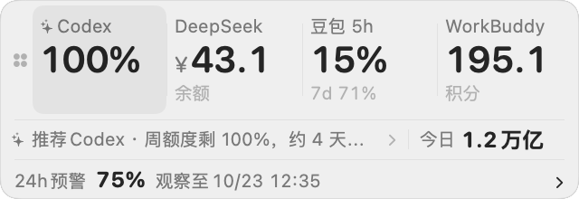

# 算力环

算力环（Compute Ring）在 Mac 桌面随时查看 Codex 账户剩余额度、今日项目 Token、额度重置预测，以及 DeepSeek、豆包、WorkBuddy、WorkBuddy AI、百度搭子、千问办公的余额/额度。

[最新版本 v1.4.0（Apple Silicon）](https://github.com/yidiandianzheng/codex-energy-bar/releases/download/v1.4.0/CodexEnergyBar-v1.4.0-macOS-arm64.zip) · [使用说明](docs/使用说明.md) · [反馈问题](https://github.com/yidiandianzheng/codex-energy-bar/issues)



*截图使用演示数据。本文描述 v1.4.1（第 78 版，构建日期 2026-10-24，本地构建、尚未发布）；上方下载链接仍为已公开的 v1.4.0。*

[浅色总览演示](docs/images/upgrade-overview-light-demo.png) · [深色总览演示](docs/images/upgrade-overview-dark-demo.png)

当前版本：**v1.4.1 · 第 78 版 · 构建 2026-10-24**（本地构建，尚未发布）。展开浮窗后标题栏第三行即可核对版本，完整记录见[更新日志](CHANGELOG.md)。

## 功能

- **账户**：顶部切换 Codex / DeepSeek / 豆包 / WorkBuddy / WorkBuddy AI / 百度搭子 / 千问办公，查看选中账户的额度细节；Codex 显示各窗口重置时间与接口提供的重置券信息。
- **今日用量**：明确区分 Codex 今日本机 Token、豆包本时段用量、DeepSeek 今日观测消耗；WorkBuddy、WorkBuddy AI、百度搭子与千问办公身份或基线无法确认时明确显示今日观测未知，其详情保留接口提供的本周期用量。缺少可信基线时显示未知。下方按项目统计本机当天 Token。
- **重置雷达**：参考两个免费公开来源；有效时间预告标为“来源预告”，与预测概率分开显示。撤回、完成或过期后清除相关预告。
- **总览**：四列展示账户与状态、剩余、用量、恢复。Codex 以当前 5 小时窗口为主数字、周额度作副行，豆包以当前时段为主并核对全部个人套餐限制；使用建议仍按各账户最紧的窗口判断。金额保留原币种；DeepSeek 优先读取人民币（CNY），千问办公显示 Credits 余额（保留 1 位小数；有套餐总额时附剩余百分比）。点行进入对应账户，DeepSeek 直接展示金额。
- **使用建议**：Mini 条与总览页根据剩余额度、余额和重置时间，用本机规则推荐现在优先用哪个 AI（不接外部 API、不联网计算）。
- **省钱灯**：Mini 条常驻一行，按内置价格表标出此刻最省的 API 模型和 DeepSeek 谷时/峰时状态；点开可看到每个模型/渠道的当前折算价、输入/输出/缓存命中价、打几折、下次变价倒计时和价格日历。不联网抓价，价格核对日期显示在页面内。分时与活动折扣规则见[价格与折扣](docs/价格与折扣.md)。
- **Mini 条按需显示**：紧凑条顶行只显示正在使用的账户实时数字，豆包、WorkBuddy、百度搭子、千问办公客户端未运行时自动隐藏、打开后自动出现；「更多」里可关闭自动隐藏。点哪一项进对应页面。
- **桌面浮窗**：拖动定位，点击展开详情，五档界面大小，跟随系统深浅外观；菜单栏图标可显示或隐藏。
- **版本信息**：展开页标题栏第三行显示版本号、第几版和构建日期；「更多 → 关于 算力环」与 `energyctl status` 同样可查，完整记录见[更新日志](CHANGELOG.md)。

## 下载与安装

适用于 **macOS 13 及以上的 Apple Silicon Mac**。Intel 兼容性尚未验证。查看账户额度前，请先在本机 Codex 登录；支持的 Codex 安装位置见[使用说明](docs/使用说明.md#额度读取失败)。

1. 下载上方 ZIP，双击解压。
2. 在 Finder 按 **Shift + Command + G**，输入 `~/Applications` 进入用户“应用程序”文件夹；若不存在，先在个人文件夹中新建 `Applications`。
3. 将 `算力环.app` 拖入该文件夹，双击打开。
4. 若 macOS 因未公证阻止打开，先尝试启动一次，再到“系统设置 → 隐私与安全性”对该应用选择“仍要打开”。

应用也可从系统 `/Applications` 目录运行；仓库中的安装与 CLI 脚本默认使用 `~/Applications/算力环.app`。

> **从旧版本升级**：应用已由「Ai算力监控」更名为「算力环」，安装路径变为 `~/Applications/算力环.app`。旧版应用不会自动删除，请手动删除 `~/Applications/Ai算力监控.app`；开启过登录自启动的，需重新执行 `scripts/enable-login-item.sh` 更新启动项。浮窗位置、尺寸与本机配置目录 `~/.config/codex-energy-bar` 沿用不变。

下载包使用**本地签名，未经过 Apple 公证**。应用没有 Dock 图标；打开后查看桌面浮窗或菜单栏图标。默认不开机自启，不安装额外后台服务。

## 基本操作

- 点击浮窗的额度、Token 或雷达区域，进入对应页面（账户 / 今日用量 / 重置雷达）；按 **Esc** 收起。
- 拖动浮窗移动位置；“更多”中可调整尺寸、恢复默认位置、隐藏或退出。
- 点击菜单栏算力图标显示或隐藏浮窗；刷新按钮只刷新当前页面。

更多操作、异常排查及倒计时规则见[使用说明](docs/使用说明.md)。本地自动化命令见 [CLI 文档](docs/CLI.md)。

## 数据来源与计算

账户额度来自本机 Codex 的 `account/rateLimits/read`。读取失败保留上次成功值并标记；Codex 超过 3 分钟、其他余额超过 15 分钟未成功更新时退出当前推荐，应用时钟会自动更新状态。所有限制窗口均有可用额度时才推荐，全部不可用时不指定账户。

总览页读取六个额外账户（分别独立、失败互不影响）：

- **DeepSeek**：官方 `https://api.deepseek.com/user/balance`，使用本机已有的 API Key（可在 `~/.config/codex-energy-bar/sources.json` 指定）。
- **豆包**：经 macOS 钥匙串授权后，在本机内存中解密豆包客户端自己的登录 Cookie，读取会员额度窗口；Cookie 不落盘。
- **WorkBuddy**：通过 WorkBuddy 客户端自己的本机 IPC 只读查询订阅积分，应用不读取或保存其 token；WorkBuddy 客户端需要保持运行。
- **WorkBuddy AI**（国际版）：与国内版走同一套本机 IPC 协议，只是读取 `~/.workbuddy-ai` 下的通道配置；同样不读取或保存其 token，客户端需要保持运行。
- **百度搭子**：在本机内存中解密百度搭子客户端自己的登录 Cookie（AES-256-GCM），查询官方积分接口的套餐与赠送包余额、到期时间；Cookie 不落盘、不外传。
- **千问办公**：通过千问办公客户端自己的本机 MCP 通道（Unix socket）只读查询 Credits 用量，应用不读取、解密或保存其登录 token；客户端需要保持运行。

省钱灯使用应用内置的静态价格表（核对日期 2026-10-23），不请求价格页；DeepSeek 峰谷、周末与法定节假日规则、WorkBuddy 积分折扣和千问渠道活动都写在对应行内，价格变动后更新应用或本地数据。

项目 Token 来自 `~/.codex/sessions` 和 `~/.codex/archived_sessions`，按上海时区自然日统计。总量为**输入 + 输出**，缓存输入和推理输出已包含在各自主项中，不重复相加。账户额度百分比与本地 Token 不能直接换算；统计不包含其他电脑的日志。

重置雷达参考 [Codex Resets](https://codex-resets.com/zh-CN) 与 [codex-reset.com](https://codex-reset.com/zh/)，无需会员或 API Key：

- 只有一站数据有效时使用该站；两站数据有效且均为未来 24 小时窗口时，各占 50% 取算术平均。
- Codex Resets 公布带日期和时刻的常规重置预告时，浮窗显示“来源预告”和倒计时；来源数据过期、预告撤回、重置完成或超过预告时刻 2 小时后清除预告。
- 不同预测窗口分别展示，不跨窗口平均；缺失、无效或过期数据不当作 0%。两站数据都要求在 30 分钟内更新。
- 详情保留各站原值、时间和链接。第三方预告不代表 OpenAI 官方确认，也不会被自动换算成 100%；双源平均是本应用计算的参考值，未经概率校准。

## 隐私

会话日志与项目统计在本机读取和计算，本应用不上传会话内容、项目路径或 Token 统计，也不修改 Codex 会话日志。账户登录与账户请求由本机 Codex 处理。

余额请求只发往 DeepSeek、豆包与百度搭子的官方接口；WorkBuddy 与千问办公的查询由各自客户端在本机完成，应用不代发。省钱灯使用应用内置的静态价格表，不请求价格页面。雷达会请求上述公开网站，向站点发送 IP 地址、应用请求标识等常规网络信息。点击来源链接会在浏览器打开网页。浮窗设置和今日观测账本保存在本机；所有刷新随应用退出而停止。

## 更新日志

| 版本 | 构建号 | 构建日期 | 状态 |
| --- | --- | --- | --- |
| v1.4.1 | 78 | 2026-10-24 | 本地构建：新增 WorkBuddy AI（国际版）与百度搭子账户；Mini 条多排、背景更透；尚未发布 |
| v1.4.0 | 75 | 2026-10-23 | 已公开发布（Apple Silicon），发布日 2026-10-24 |
| v1.3.4 | 72 | 2026-10-22 | 已公开发布（Apple Silicon） |

完整改动与更早版本记录见 [CHANGELOG.md](CHANGELOG.md)。从 v1.3.4 到 v1.4.1：版本号 1.3.4 → 1.4.0 → 1.4.1；构建号 72 → 75 → 76。应用内可在标题栏第三行、「更多 → 关于 算力环」或 `energyctl status` 查看当前构建的版本号、第几版与构建日期。

## 从源码构建

需要 Git、Swift 6 工具链和 macOS SDK（可通过 Xcode 或 Command Line Tools 提供）。

```bash
git clone https://github.com/yidiandianzheng/codex-energy-bar.git
cd codex-energy-bar
./scripts/build-app.sh
```

脚本输出生成的 `.app` 路径。可用 `CODEX_PET_ENERGY_SDK` 指定 SDK，`CODEX_PET_ENERGY_BUILD_DIR` 指定应用输出目录，`CODEX_PET_ENERGY_SWIFT_BUILD_PATH` 指定独立构建缓存，`CODEX_PET_ENERGY_BUILD_DATE` 指定写入 App 包的构建日期（默认取打包当天，Asia/Shanghai）。内部可执行文件名仍为 `CodexPetEnergy`。

如果构建时报错 `external macro implementation type 'SwiftUIMacros.StateMacro' could not be found`，说明当前命令行工具链的默认 SDK 缺少 SwiftUI 宏插件（安装完整 Xcode 通常可解决）；也可以用 `CODEX_PET_ENERGY_SDK` 指向一个可用的 `MacOSX*.sdk`。

[贡献指南](CONTRIBUTING.md) · [安全问题](SECURITY.md) · [MIT 许可](LICENSE)
